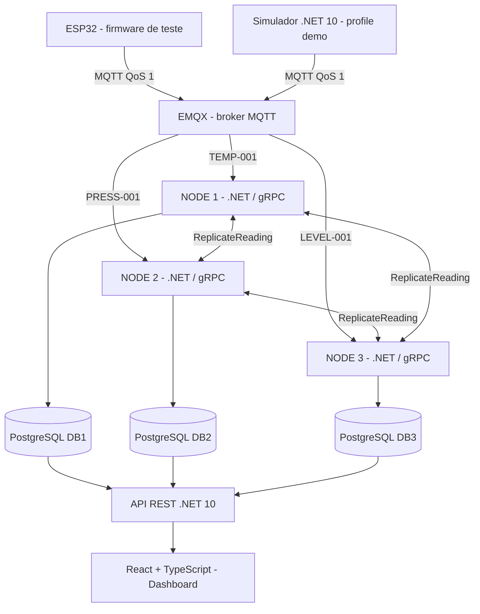

# IoTDistributed

**Plataforma acadêmica de sensores IoT com MQTT, comunicação gRPC entre nós, replicação de eventos em três bancos PostgreSQL e monitoramento web.**

Projeto de **Computação Distribuída** que demonstra comunicação entre processos, armazenamento independente por nó, replicação de dados, identificação de divergências e observação de falhas. É possível executar o ambiente completo **sem ESP32 físico** usando o simulador .NET.

> **Execução rápida para apresentação:** instale Docker Desktop e Git, clone o repositório e, dentro de `src/IoTDistributed.Node`, execute `docker compose --profile demo up -d --build`. Depois acesse **http://localhost:5173**.

## Índice

1. [Objetivo e conceitos](#objetivo-e-conceitos)
2. [Arquitetura e fluxo de dados](#arquitetura-e-fluxo-de-dados)
3. [Estrutura do repositório](#estrutura-do-repositório)
4. [Tecnologias](#tecnologias)
5. [Pré-requisitos](#pré-requisitos)
6. [Executar com Docker](#executar-com-docker)
7. [Simulador .NET e ESP32](#simulador-net-e-esp32)
8. [Detalhamento dos projetos](#detalhamento-dos-projetos)
9. [Endpoints da API](#endpoints-da-api)
10. [Comparação e consistência das réplicas](#comparação-e-consistência-das-réplicas)
11. [Consultas SQL e testes de comunicação](#consultas-sql-e-testes-de-comunicação)
12. [Roteiro de demonstração de falhas](#roteiro-de-demonstração-de-falhas)
13. [Desenvolvimento local e CI](#desenvolvimento-local-e-ci)
14. [Problemas frequentes](#problemas-frequentes)
15. [Limitações e próximos passos](#limitações-e-próximos-passos)

## Objetivo e conceitos

O objetivo é reproduzir, em escala acadêmica, um sistema em que **diferentes nós de processamento recebem medições IoT e mantêm cópias dos eventos em bancos independentes**.

Conceitos implementados ou explorados:

- **Sistemas distribuídos:** três instâncias .NET executam separadamente, usando o mesmo código e configurações diferentes.
- **Comunicação assíncrona:** o broker **EMQX** recebe publicações MQTT dos sensores e entrega aos nós inscritos.
- **Comunicação RPC:** os nós trocam requisições **gRPC/HTTP/2**, com contratos Protocol Buffers.
- **Replicação entre nós:** o nó responsável por cada sensor persiste a leitura e tenta enviar cópias aos outros dois nós.
- **Idempotência:** o identificador único `event_id` impede uma segunda inserção do mesmo evento no mesmo banco.
- **Observabilidade:** uma API REST permite consultar leituras, estado dos bancos e divergências; o React exibe esses dados.
- **Análise de falhas:** é possível parar um nó, observar réplicas faltantes e identificar os eventos ausentes.

**Importante:** cada nó tem um *banco principal próprio*, mas todos os bancos devem poder armazenar eventos dos três sensores após a replicação. Isso **não** é a replicação nativa do PostgreSQL: a cópia de eventos é implementada na aplicação por gRPC. Também **não** há eleição de líder global.

## Arquitetura e fluxo de dados



### Sequência de uma medição

1. O ESP32 **ou** o `IoTDistributed.Simulator` gera uma leitura, um GUID v4 (`event_id`) e um horário UTC.
2. O produtor publica JSON no tópico MQTT associado ao sensor.
3. O **EMQX** entrega a mensagem ao nó inscrito naquele tópico.
4. O `MqttSensorWorker` valida o JSON e chama `SensorIngestionService`.
5. O serviço valida o sensor, seu **nó proprietário** e o tópico recebido; então persiste a leitura no PostgreSQL local.
6. Se o evento foi inserido pela primeira vez, `ReplicationService` envia chamadas gRPC `ReplicateReading` aos outros dois nós.
7. Cada destinatário grava a cópia em seu próprio PostgreSQL, preservando o `event_id` e o nó de origem.
8. A API consulta os bancos e disponibiliza medições e comparações; o dashboard apresenta resultados e divergências.

O fluxo de entrada é **MQTT → processamento local → gRPC entre nós**. O frontend não escreve diretamente no banco.

### Sensores configurados

| Sensor | Tipo | Nó proprietário | Tópico MQTT | Faixa gerada nos simuladores |
|---|---|---|---|---|
| `TEMP-001` | Temperatura | NODE 1 | `iot/sensors/TEMP-001/readings` | 20–35 °C |
| `PRESS-001` | Pressão | NODE 2 | `iot/sensors/PRESS-001/readings` | 0,80–1,60 bar |
| `LEVEL-001` | Nível | NODE 3 | `iot/sensors/LEVEL-001/readings` | 15–95% |

### Exemplo de mensagem MQTT

```json
{
  "event_id": "f6d87657-5b0c-4c47-b9a9-fca7b8bb2345",
  "sensor_id": "TEMP-001",
  "value": 28.50,
  "collected_at_utc": "2026-10-31T21:00:00Z"
}
```

Os campos são `event_id` (GUID), `sensor_id`, `value` (número) e `collected_at_utc` (UTC no formato ISO 8601). O firmware e o Worker usam **QoS 1** e `retain=false`.

## Estrutura do repositório

```text
IoTDistributed/
├── IotDistributed.slnx
├── database/
│   ├── 001_initial_schema.sql
│   └── 002_add_mqtt_topic.sql
├── src/
│   ├── IoTDistributed.Node/
│   │   ├── Program.cs
│   │   ├── Protos/cluster.proto
│   │   ├── Services/
│   │   │   ├── ClusterGrpcService.cs
│   │   │   ├── ReplicationService.cs
│   │   │   └── SensorIngestionService.cs
│   │   ├── Workers/
│   │   │   ├── MqttSensorWorker.cs
│   │   │   ├── DatabaseConnectionWorker.cs
│   │   │   └── PeerPingWorker.cs
│   │   ├── Persistance/SensorRepository.cs
│   │   ├── Dockerfile
│   │   ├── compose.yml
│   │   └── compose.dev.yml
│   ├── IoTDistributed.Api/
│   │   ├── Controllers/
│   │   ├── Models/
│   │   ├── Database/ClusterDataSources.cs
│   │   ├── Persistance/
│   │   ├── Services/ReplicationComparisonService.cs
│   │   └── Dockerfile
│   └── IoTDistributed.Simulator/
│       ├── Program.cs
│       ├── Workers/SensorSimulatorWorker.cs
│       ├── Models/
│       ├── Dockerfile
│       └── README.md
├── firmware/
│   └── esp32-sensor-simulator/
│       ├── main/main.c
│       ├── main/Kconfig.projbuild
│       └── README.md
├── frontend/
│   └── iotdistributed-web/
│       ├── src/
│       │   ├── components/
│       │   ├── hooks/
│       │   ├── services/
│       │   └── types/
│       ├── Dockerfile
│       ├── Dockerfile.dev
│       ├── nginx.conf
│       └── vite.config.ts
└── .github/workflows/
    ├── frontend.yml
    └── simulator.yml
```

A solução `IotDistributed.slnx` referencia atualmente **Node** e **Api**. O projeto **Simulator** tem seu próprio `.csproj` e é compilado pelo Dockerfile, pelo comando `dotnet build --project ...` (ver abaixo) ou pelo CI separadamente.

## Tecnologias

| Camada | Tecnologia | Uso |
|---|---|---|
| Nós distribuídos | .NET 10 / ASP.NET Core | Processo único configurável por `NODE_ID` |
| RPC | gRPC, HTTP/2, Protocol Buffers | Comunicação e envio de réplicas entre nós |
| Mensageria IoT | MQTT / EMQX 5.8.8 | Publicação e assinatura por tópico |
| Clientes MQTT | MQTTnet | Consumo nos nós e publicação no simulador .NET |
| Persistência | PostgreSQL 17 | Três instâncias e volumes independentes |
| Acesso a dados | Npgsql + Dapper | SQL explícito e leitura/gravação |
| API | ASP.NET Core Web API (.NET 10) | Endpoints REST para o dashboard |
| Frontend | React 19, TypeScript, Vite | Gráficos, sensores, tabelas, replicação |
| Frontend em produção | Nginx | Arquivos estáticos e proxy de `/api` |
| Firmware | ESP-IDF 6.1 (ESP32) | Simulação de sensores em hardware físico |
| Infraestrutura | Docker Compose | Inicialização e interconexão dos serviços |

## Pré-requisitos

### Para executar tudo pelo Docker (recomendado)

- **Docker Desktop**, com engine de contêineres Linux e `docker compose` disponíveis.
- **Git**, para clonar e atualizar o repositório.
- Navegador web.
- Portas disponíveis, conforme a tabela abaixo.

**Não é necessário instalar .NET, Node.js, PostgreSQL ou EMQX no Windows** para o cenário Docker: as imagens contêm os runtimes e as dependências.

Comandos para verificar:

```powershell
git --version
docker --version
docker compose version
docker info
```

### Apenas para desenvolvimento fora do Docker

- SDK **.NET 10** para compilar Node, API e Simulator localmente.
- **Node.js compatível com o Vite do projeto** para executar o frontend sem contêiner.
- **ESP-IDF 6.1** e ferramenta de gravação para testar o firmware no ESP32.

### Portas publicadas pelo Compose

| Porta no computador | Serviço | Finalidade |
|---|---|---|
| `5173` | Frontend (Nginx) | Dashboard React |
| `6100` | API REST | Requisições `/api/...` |
| `5001` | NODE 1 | gRPC / HTTP/2 |
| `5002` | NODE 2 | gRPC / HTTP/2 |
| `5003` | NODE 3 | gRPC / HTTP/2 |
| `5433` | DB1 | PostgreSQL local |
| `5434` | DB2 | PostgreSQL local |
| `5435` | DB3 | PostgreSQL local |
| `1883` | EMQX | MQTT/TCP |
| `18083` | EMQX | Interface administrativa |
| `5174` | Frontend de desenvolvimento | Somente com `compose.dev.yml` |

Os nomes `db1`, `db2`, `db3`, `api` e `emqx` são resolvidos **entre contêineres** pela rede do Compose. No computador hospedeiro, use `localhost` e a porta publicada. No ESP32 conectado por Wi-Fi, use o **IP local do computador**, nunca `emqx` ou `localhost`.

## Executar com Docker

Os exemplos abaixo utilizam **Windows PowerShell** e pressupõem que o Docker Desktop esteja em execução.

### 1. Clonar o repositório

```powershell
git clone https://github.com/brunogbitencourt/IoTDistributed.git
cd IoTDistributed
```

Se o repositório já estiver clonado:

```powershell
cd C:\Projetos\IotDistributed
git status
git pull origin main
```

Caso existam alterações locais, revise ou salve-as antes do `git pull`.

### 2. Abrir a pasta do Compose

**Importante:** o Compose principal fica dentro de `src/IoTDistributed.Node`.

```powershell
cd src\IoTDistributed.Node
docker compose config --services
```

O comando lista os serviços reconhecidos, como `node-1`, `node-2`, `node-3`, `db1`, `db2`, `db3`, `db-init`, `api`, `frontend` e `emqx`. O `simulator` está no perfil opcional `demo`.

### 3A. Inicializar o ambiente sem simulador

Use esta opção quando houver um ESP32 real publicando:

```powershell
docker compose up -d --build
```

O parâmetro `--build` monta as imagens locais; `-d` executa os serviços em segundo plano. O serviço `db-init` aguarda o PostgreSQL e executa os scripts de `database/`.

### 3B. Inicializar o ambiente completo COM simulador (sem ESP32)

**Esta é a forma recomendada para uma demonstração ao professor.**

```powershell
docker compose --profile demo up -d --build
```

O perfil `demo` acrescenta o contêiner `simulator` aos serviços normais. Ele publica **três mensagens a cada 5 segundos**, uma por sensor, nos mesmos tópicos do firmware.

Se o ambiente normal já estiver funcionando e quiser apenas ativar o simulador e suas dependências:

```powershell
docker compose --profile demo up -d --build simulator
```

### 4. Verificar os contêineres

```powershell
docker compose ps -a
docker compose --profile demo ps -a
```

O serviço **`db-init` pode aparecer como `Exited (0)`**: isso é esperado, pois ele termina depois de inicializar os esquemas. Os serviços de execução contínua devem ficar ativos.

### 5. Abrir as interfaces

- **Dashboard React:** http://localhost:5173
- **API – saúde do processo:** http://localhost:6100/api/cluster/health
- **API – sensores:** http://localhost:6100/api/sensors
- **EMQX Dashboard:** http://localhost:18083

A URL de saúde da API confirma que **o processo da API respondeu**; não prova, sozinha, que os três bancos ou nós estejam saudáveis. Para os bancos, consulte `/api/cluster/databases`.

### 6. Acompanhar o fluxo pelos logs

```powershell
# Publicações do simulador (quando o perfil demo estiver ativo)
docker compose logs -f simulator

# Consumo MQTT, gravação e replicação dos três nós
docker compose logs -f node-1 node-2 node-3

# API REST
docker compose logs -f api

# Broker MQTT
docker compose logs --tail 80 emqx
```

Use `Ctrl+C` para sair da visualização de logs; isso **não desliga** o contêiner.

### 7. Parar e reiniciar

```powershell
# Parar e remover os contêineres da aplicação sem apagar volumes
docker compose --profile demo down

# Recriar e iniciar tudo novamente com o simulador
docker compose --profile demo up -d --build

# Reiniciar serviços existentes, sem reconstruir imagens
docker compose restart
```

Para desativar **somente o simulador** e manter broker, nós, API e bancos:

```powershell
docker compose --profile demo stop simulator
```

Para removê-lo da lista de contêineres após pará-lo:

```powershell
docker compose --profile demo rm -f simulator
```

**Atenção:** `docker compose down` mantém os volumes persistentes. **Não utilize `docker compose down -v`** se quiser preservar os dados de `db1`, `db2` e `db3`; essa opção remove os volumes gerenciados pelo Compose.

## Simulador .NET e ESP32

### `src/IoTDistributed.Simulator` — publicador de demonstração

É um **Worker Service .NET 10** que usa `BackgroundService`, `PeriodicTimer` e MQTTnet:

- Conecta-se ao broker com um **Client ID exclusivo**, diferente do ESP32 e dos nós.
- Gera valores aleatórios nas faixas definidas para os três sensores.
- Publica JSON com `event_id` novo, `sensor_id`, `value` e `collected_at_utc`.
- Usa MQTT QoS 1, sem `retain`, e tenta reconectar em um ciclo futuro se houver falha.
- Não acessa PostgreSQL, API ou gRPC diretamente.
- Fica **desligado por padrão** e só inicia com `--profile demo`.

O intervalo padrão é definido por `Simulator__IntervalSeconds: "5"` no `compose.yml`. Para alterá-lo, edite essa variável e recrie o serviço:

```powershell
docker compose --profile demo up -d --force-recreate simulator
```

Documentação adicional: [README do Simulator](src/IoTDistributed.Simulator/README.md).

### `firmware/esp32-sensor-simulator` — firmware ESP32

O firmware também gera **leituras simuladas** (não requer sensores eletrônicos conectados), mas executa em um ESP32 físico:

- Configura Wi-Fi via `idf.py menuconfig`.
- Sincroniza o relógio com NTP antes de publicar.
- Gera GUIDs, valores aleatórios e publica via MQTT QoS 1.
- O intervalo padrão do firmware é **10 segundos**, configurável no `menuconfig`.
- Utiliza os mesmos três tópicos e a mesma estrutura de JSON do Worker .NET.

**Para usar o ESP32**, obtenha o IP local do computador:

```powershell
ipconfig
```

Configure no ESP-IDF o broker como `mqtt://IP_DO_PC:1883`; conecte ESP32 e computador na mesma rede acessível. O `compose.yml` atual publica `1883:1883` no hospedeiro. Permita TCP 1883 no firewall **somente em redes privadas confiáveis**, sem expor o broker à Internet. O `emqx:1883` é um endereço interno do Docker e não funciona no ESP32.

Com a ferramenta ESP-IDF instalada:

```powershell
cd firmware\esp32-sensor-simulator
idf.py set-target esp32
idf.py menuconfig
idf.py build
idf.py -p COM4 flash monitor
```

Substitua `COM4` pela porta serial correta e configure SSID, senha, broker e NTP no `menuconfig`.

Instruções completas: [README do firmware ESP32](firmware/esp32-sensor-simulator/README.md).

**Coexistência:** ESP32 e Worker .NET podem se conectar simultaneamente sem disputa de Client ID, mas publicarão eventos diferentes para os mesmos sensores. Para manter a demonstração organizada, use apenas um produtor por vez.

## Detalhamento dos projetos

### 1. `IoTDistributed.Node` — nós distribuídos e gRPC

O mesmo projeto .NET 10 é executado **três vezes**, com variáveis de ambiente distintas:

| Instância | `NODE_ID` | Banco principal | Porta gRPC no host | Sensor atribuído |
|---|---:|---|---:|---|
| `node-1` | 1 | `db1:5432` | 5001 | Temperatura |
| `node-2` | 2 | `db2:5432` | 5002 | Pressão |
| `node-3` | 3 | `db3:5432` | 5003 | Nível |

No Docker, o servidor gRPC de cada nó escuta na porta `8080`, em **HTTP/2 sem TLS (h2c)**, dentro da rede de laboratório. Os demais nós se comunicam pelos nomes `node-1`, `node-2` e `node-3`; as portas 5001–5003 servem para acessar cada nó a partir do host.

Arquivos principais:

| Arquivo | Responsabilidade |
|---|---|
| [`Program.cs`](src/IoTDistributed.Node/Program.cs) | Configura Kestrel/gRPC, PostgreSQL, repositórios e Workers |
| [`Protos/cluster.proto`](src/IoTDistributed.Node/Protos/cluster.proto) | Contrato das operações RPC e mensagens |
| [`ClusterGrpcService.cs`](src/IoTDistributed.Node/Services/ClusterGrpcService.cs) | Implementa os métodos gRPC |
| [`MqttSensorWorker.cs`](src/IoTDistributed.Node/Workers/MqttSensorWorker.cs) | Conexão MQTT e assinatura dos tópicos do nó |
| [`SensorIngestionService.cs`](src/IoTDistributed.Node/Services/SensorIngestionService.cs) | Validação, gravação inicial e disparo da replicação |
| [`ReplicationService.cs`](src/IoTDistributed.Node/Services/ReplicationService.cs) | Envios gRPC aos peers |
| [`SensorRepository.cs`](src/IoTDistributed.Node/Persistance/SensorRepository.cs) | SQL com Dapper/Npgsql |
| [`DatabaseConnectionWorker.cs`](src/IoTDistributed.Node/Workers/DatabaseConnectionWorker.cs) | Teste e log da conexão inicial ao banco |
| [`PeerPingWorker.cs`](src/IoTDistributed.Node/Workers/PeerPingWorker.cs) | Implementação opcional de chamadas periódicas a `Ping` |

**Atenção:** `PeerPingWorker` existe no código, mas **não está registrado como hosted service** no `Program.cs` atual. O método RPC `Ping` funciona sob chamada, porém o monitoramento periódico de peers **não está ativo por padrão**.

### Métodos gRPC definidos

| Método | Direção / finalidade |
|---|---|
| `Ping(PingRequest) → PingReply` | Um nó ou cliente verifica se o serviço RPC de outro nó responde |
| `SubmitReading(SensorReadingRequest) → SensorReadingReply` | Entrada de medição via gRPC com validação de proprietário |
| `ReplicateReading(ReplicateReadingRequest) → ReplicateReadingReply` | Nó de origem envia um evento para ser persistido como réplica |

Os contratos estão em [`cluster.proto`](src/IoTDistributed.Node/Protos/cluster.proto). As classes `ClusterClient`, mensagens e clientes assíncronos são gerados a partir do arquivo `.proto` durante o build.

No fluxo normal MQTT, **`ReplicateReading`** é o método de comunicação entre réplicas. `SubmitReading` está disponível para entrada via RPC, sem ser o caminho usado pelo firmware.

A propriedade `PEERS` do Compose identifica os dois vizinhos de cada nó. Exemplo de `node-1`:

```text
2=http://node-2:8080;3=http://node-3:8080
```

`ReplicationService` envia as requisições aos dois peers de maneira concorrente (via `Task.WhenAll`), com **prazo de três segundos por chamada**. O serviço registra o número de peers que confirmaram. Nesta versão, falhas de replicação **não são enfileiradas para reenvio posterior**.

### 2. `IoTDistributed.Api` — API REST

API ASP.NET Core .NET 10 separada dos nós. Usa **Dapper**, **Npgsql** e `ClusterDataSources` para consultar os três bancos.

Responsabilidades:

- Listar sensores e seus tópicos/identificadores;
- Consultar leituras, inclusive por nó e sensor;
- Verificar disponibilidade de cada banco;
- Consultar a presença de um `event_id` em cada banco;
- Comparar os conjuntos de GUIDs por janela UTC e indicar divergências.

A API é **de consulta** nos endpoints implementados. Ela não gera nem replica medições.

Arquivos de interesse: [Controllers](src/IoTDistributed.Api/Controllers), [ReadingRepository](src/IoTDistributed.Api/Persistance/ReadingRepository.cs) e [ReplicationComparisonService](src/IoTDistributed.Api/Services/ReplicationComparisonService.cs).

### 3. `IoTDistributed.Simulator` — fonte de dados sem hardware

Aplicação console/Worker Service .NET 10. Publica eventos MQTT idênticos aos do ESP32 no perfil `demo`. Seu principal serviço é [`SensorSimulatorWorker.cs`](src/IoTDistributed.Simulator/Workers/SensorSimulatorWorker.cs).

### 4. `frontend/iotdistributed-web` — monitoramento React

Aplicação React/TypeScript com três áreas principais e uma tela dedicada à replicação:

- **Visão geral:** indicadores, sensores, valores e gráfico de histórico;
- **Medições:** consulta das amostras, filtro por sensor e exportação CSV;
- **Infraestrutura:** estado de DB1/DB2/DB3 e desenho do fluxo;
- **Replicação:** comparação dos GUIDs, eventos ausentes, eventos presentes em apenas um banco, filtros por DB, pesquisa e exportação CSV.

O dashboard atualiza sensores/leituras aproximadamente a cada **10 segundos** (polling). A tela de replicação faz consultas aproximadamente a cada **30 segundos** enquanto a atualização automática está habilitada. A API fornece os dados reais; os valores apresentados não são gerados no frontend.

No Docker de apresentação, o Vite compila o frontend e o **Nginx** serve a pasta `dist/`, encaminhando `/api` para `http://api:8080`.

### 5. `database` — esquema e preparação

O serviço `db-init` executa os scripts SQL sobre **cada um dos três bancos** após seus healthchecks:

- [`001_initial_schema.sql`](database/001_initial_schema.sql): cria as tabelas `sensors` e `sensor_readings`, o índice e os três sensores iniciais;
- [`002_add_mqtt_topic.sql`](database/002_add_mqtt_topic.sql): acrescenta `mqtt_topic` e preenche os tópicos MQTT para os sensores cadastrados.

Estrutura de `sensor_readings`:

| Coluna | Uso |
|---|---|
| `event_id UUID PRIMARY KEY` | Identificador do evento e chave de idempotência |
| `sensor_id` | Sensor que originou a leitura |
| `value` | Valor medido |
| `collected_at` | Instante da coleta |
| `origin_node_id` | Nó proprietário que originou a medição |
| `created_at` | Instante em que aquele banco gravou a linha |

A instrução SQL `ON CONFLICT (event_id) DO NOTHING` evita inserir duas vezes o mesmo GUID. As cópias de **um mesmo evento em bancos diferentes são esperadas**, não são duplicatas inválidas.

Os scripts são executados pelo contêiner `db-init`; isso **não** representa um sistema de migrações versionadas. Os scripts atuais foram escritos para admitir reaplicação sem apagar dados existentes.

## Endpoints da API

Base local: **`http://localhost:6100`**.

Os exemplos abaixo podem ser executados no **PowerShell** depois de iniciar o Compose.

| Método e rota | Descrição |
|---|---|
| `GET /api/cluster/health` | Informa que o processo da API está respondendo |
| `GET /api/cluster/databases` | Estado de cada conexão ao DB1, DB2 e DB3 e número de sensores |
| `GET /api/sensors` | Sensores cadastrados (consulta o repositório de sensores) |
| `GET /api/readings?node=1&limit=20` | Leituras do DB1, ordenadas por gravação recente |
| `GET /api/readings?node=2&sensorId=PRESS-001&limit=1` | Última leitura armazenada de um sensor no DB2 |
| `GET /api/readings/{eventId}/replicas` | Presença do evento em cada banco: `present`, `missing` ou `unavailable` |
| `GET /api/replication/divergences` | Divergências dos últimos 15 minutos (padrão) |
| `GET /api/replication/divergences?fromUtc=...&toUtc=...` | Compara período UTC explícito, até 1 hora |

### Requisições básicas

```powershell
curl.exe http://localhost:6100/api/cluster/health
curl.exe http://localhost:6100/api/cluster/databases
curl.exe http://localhost:6100/api/sensors

curl.exe "http://localhost:6100/api/readings?node=1&limit=20"
curl.exe "http://localhost:6100/api/readings?node=2&sensorId=PRESS-001&limit=1"
curl.exe "http://localhost:6100/api/readings?node=3&sensorId=LEVEL-001&limit=10"

# Últimos 15 minutos, usando o padrão do backend
curl.exe http://localhost:6100/api/replication/divergences
```

O parâmetro `node` aceita **1–3**; `limit` aceita **1–100**. O campo `sensorId` é opcional. Uma lista `[]` indica que não há leituras correspondentes no banco consultado.

### Consultar a replicação de um GUID específico

Obtenha um `eventId` real da resposta de `/api/readings` e substitua abaixo:

```powershell
curl.exe "http://localhost:6100/api/readings/COLE_AQUI_UM_GUID_REAL/replicas"
```

Exemplo **ilustrativo** de retorno:

```json
{
  "eventId": "f6d87657-5b0c-4c47-b9a9-fca7b8bb2345",
  "replicas": [
    { "nodeId": 1, "status": "present" },
    { "nodeId": 2, "status": "present" },
    { "nodeId": 3, "status": "missing" }
  ]
}
```

### Consultar uma janela personalizada

O endpoint recebe **ambos** `fromUtc` e `toUtc` ou nenhum; exige `fromUtc < toUtc` e aceita no máximo **1 hora**. No PowerShell:

```powershell
$to = [DateTimeOffset]::UtcNow
$from = $to.AddMinutes(-30)

$query = "fromUtc=$([uri]::EscapeDataString($from.ToString('o')))&toUtc=$([uri]::EscapeDataString($to.ToString('o')))"
Invoke-RestMethod "http://localhost:6100/api/replication/divergences?$query"
```

## Comparação e consistência das réplicas

**Problema:** como saber se o mesmo evento, identificado por GUID, chegou aos três PostgreSQL?

A implementação em [`ReplicationComparisonService`](src/IoTDistributed.Api/Services/ReplicationComparisonService.cs) aplica **operações de conjuntos** sobre os eventos de cada banco, dentro do período solicitado:

1. Para cada banco acessível, lê os `event_id` com `collected_at` no intervalo UTC.
2. Converte os identificadores em `HashSet<Guid>`, removendo repetições na análise.
3. Calcula a **união** dos conjuntos.
4. Calcula, para cada banco, `união - eventos_do_banco`.
5. Agrupa os identificadores ausentes e indica os nós (`missingInNodes`) correspondentes.

Exemplo ilustrativo:

```text
DB1 = { A, B, C }
DB2 = { A, B }
DB3 = { A, C }

União = { A, B, C }

Evento A: presente nos três bancos
Evento B: ausente no DB3
Evento C: ausente no DB2
```

No dashboard, a aba **Replicação** mostra:

- **GUIDs distintos:** total de eventos diferentes observados nos bancos consultados;
- **Eventos divergentes:** GUIDs presentes em pelo menos um banco acessível e ausentes em outro;
- **Presentes em apenas um banco:** eventos exclusivos dentro da comparação observável;
- **Quantidade por PostgreSQL:** eventos distintos de cada banco no período;
- **Tabela de GUIDs:** indicação de `Presente`, `Ausente` ou `Não consultado` em DB1, DB2 e DB3;
- **Filtros:** 5, 15, 30 ou 60 minutos; GUID; ausentes por banco; somente exclusivos; exportação CSV.

**Cuidado ao interpretar o resultado:**

- Se um banco estiver indisponível, a API devolve `allDatabasesAvailable: false`; a comparação é **parcial**. Não se pode afirmar que todos os bancos estão iguais.
- Se os conjuntos estiverem iguais na janela, isso **não significa** que dados mais antigos estejam sincronizados.
- A comparação identifica **eventos que faltam em réplicas**, não linhas duplicadas fisicamente dentro da mesma tabela.
- A API **detecta** divergências, mas não **repara** automaticamente eventos ausentes.
- O `GET /api/cluster/databases` verifica a conexão SQL; não informa, por si só, se o serviço gRPC do nó correspondente está executando.

## Consultas SQL e testes de comunicação

Todos os comandos abaixo partem de `src/IoTDistributed.Node`, com o Docker Compose em execução.

### Contagem total de eventos em cada banco

```powershell
docker compose exec db1 psql -U iot -d iotdb -c "SELECT COUNT(*) FROM sensor_readings;"
docker compose exec db2 psql -U iot -d iotdb -c "SELECT COUNT(*) FROM sensor_readings;"
docker compose exec db3 psql -U iot -d iotdb -c "SELECT COUNT(*) FROM sensor_readings;"
```

As contagens **não precisam ser idênticas** se houve falha de replicação ou perda de mensagens. Compare os GUIDs para localizar diferenças.

### Ver últimas leituras

```powershell
docker compose exec db1 psql -U iot -d iotdb -c "SELECT event_id, sensor_id, value, origin_node_id, collected_at FROM sensor_readings ORDER BY created_at DESC LIMIT 10;"
```

### Verificar eventos por sensor nos últimos minutos

```powershell
docker compose exec db1 psql -U iot -d iotdb -c "SELECT sensor_id, COUNT(*) FROM sensor_readings WHERE created_at > NOW() - INTERVAL '3 minutes' GROUP BY sensor_id ORDER BY sensor_id;"
```

### Verificar a conexão HTTP/2/gRPC (opcional)

Se possuir **grpcurl** instalado no computador, é possível chamar `Ping` mesmo sem o worker periódico habilitado:

```powershell
cd C:\Projetos\IotDistributed

grpcurl -plaintext -import-path src/IoTDistributed.Node/Protos -proto cluster.proto -d '{"senderId":2}' localhost:5001 cluster.Cluster/Ping
```

O `node-1` deve responder com o identificador do nó (`responderId: 1`) e `success: true`. Usamos `-plaintext` porque a porta gRPC do laboratório está configurada sem TLS. Se não tiver `grpcurl`, essa etapa é opcional e não impede a execução do projeto.

## Roteiro de demonstração de falhas

Esta sequência ilustra **comunicação distribuída, replicação e identificação de inconsistências** de modo reproduzível.

**1. Iniciar o ambiente completo com o simulador:**

```powershell
cd C:\Projetos\IotDistributed\src\IoTDistributed.Node
docker compose --profile demo up -d --build
```

Abra http://localhost:5173. Confirme que os valores dos três sensores estão mudando e que `/api/cluster/databases` indica os bancos disponíveis.

**2. Conferir a replicação inicialmente:**

Abra a aba **Replicação**, escolha a janela de **5 minutos** e verifique os GUIDs e o resumo de divergências. Se houver dados anteriores ou falhas prévias, o resultado pode não estar zerado.

**3. Simular falha de um PROCESSO de nó, mantendo seu banco acessível:**

```powershell
docker compose stop node-3
```

Mantenha o simulador executando e deixe novas leituras serem publicadas. O `node-1` e o `node-2` continuam processando seus respectivos sensores, mas tentativas de replicação ao `node-3` falham. O **DB3 continua online**, permitindo que a API compare os eventos de cada banco.

**4. Observar as divergências:**

Na aba **Replicação**, clique em **Comparar agora** ou aguarde a próxima consulta. Registros originados em outros nós poderão aparecer como **ausentes no DB3**. Inspecione também os logs:

```powershell
docker compose logs --tail 100 node-1 node-2
curl.exe http://localhost:6100/api/replication/divergences
```

**5. Recuperar o processo:**

```powershell
docker compose start node-3
docker compose ps -a
```

**Resultado esperado e limitação:** o nó volta a processar novas mensagens, mas o código atual **não possui mecanismo automático de reparação das leituras perdidas** durante a indisponibilidade. Divergências antigas podem permanecer visíveis enquanto seus `collected_at` estiverem na janela selecionada. Não há garantia de zero divergências após reiniciar o processo.

> **Experimento diferente:** parar `db3`, em vez de `node-3`, torna o banco inacessível. Nesse cenário a comparação será **parcial** e o painel deverá sinalizar que não consegue confirmar os registros daquele banco. Para recuperá-lo: `docker compose start db3`.

## Desenvolvimento local e CI

### Compilar projetos .NET individualmente

Na **raiz do repositório**, com o SDK .NET 10 instalado:

```powershell
dotnet --version

dotnet build src/IoTDistributed.Node/IoTDistributed.Node.csproj
dotnet build src/IoTDistributed.Api/IoTDistributed.Api.csproj
dotnet build src/IoTDistributed.Simulator/IoTDistributed.Simulator.csproj
```

Para executar o **simulador fora do Docker**, mantenha o EMQX iniciado na porta `1883`:

```powershell
dotnet run --project src/IoTDistributed.Simulator/IoTDistributed.Simulator.csproj
```

O `appsettings.json` do Worker utiliza `localhost:1883` para execução fora do Compose. Os nós/API locais necessitam de configurações de conexão ao banco e portas apropriadas. Para reproduzir o ambiente completo de maneira uniforme, prefira o Compose.

### Frontend com Vite em modo de desenvolvimento

Existe uma configuração opcional com hot reload **dentro de Docker**. Na pasta `src/IoTDistributed.Node`:

```powershell
docker compose -f compose.yml -f compose.dev.yml up -d --build frontend-dev
```

Acesse http://localhost:5174. O frontend de produção continua em http://localhost:5173. O Vite utiliza proxy `/api` para `http://api:8080`.

### Validar o Docker Compose

```powershell
docker compose config --services
docker compose --profile demo config --services
docker compose config
```

### Integração contínua

A pasta `.github/workflows` contém:

- [`frontend.yml`](.github/workflows/frontend.yml): instala dependências, compila TypeScript/Vite e executa lint;
- [`simulator.yml`](.github/workflows/simulator.yml): restaura e compila .NET 10, valida o perfil do Compose, constrói a imagem do Worker e executa teste de publicação MQTT com EMQX.

Esses workflows **não substituem** um teste completo de ponta a ponta com os três bancos e a API; eles verificam os componentes documentados em cada pipeline.

## Problemas frequentes

| Sintoma | Verificação / solução |
|---|---|
| `docker compose` não funciona | Inicie Docker Desktop e valide `docker info`. |
| `emqx` não aparece | Confirme que está no diretório `src/IoTDistributed.Node`; use `docker compose config --services` e `docker compose ps -a`. |
| `simulator` não está iniciado | Ele é opcional: inicie com `docker compose --profile demo up -d --build simulator`. |
| Sem medições no dashboard | Confira `docker compose logs -f simulator`, `emqx` e `node-1 node-2 node-3`. No ambiente sem ESP32, o perfil `demo` deve estar ativo. |
| API não responde | Use `docker compose logs --tail 100 api` e `docker compose ps -a`. |
| `db-init` aparece `Exited (0)` | É esperado após executar os scripts. |
| Erro de conexão ao PostgreSQL | Verifique `docker compose ps -a`, os healthchecks de `db1`–`db3` e as portas ocupadas. |
| Os três bancos possuem contagens diferentes | Consulte a tela **Replicação**; o aplicativo identifica GUIDs ausentes, mas ainda não faz reparação automática. |
| ESP32 não conecta ao broker | Use o IP IPv4 do computador na rede, confira TCP 1883, Wi-Fi 2,4 GHz, NTP e firewall privado. |
| Porta 5173/6100/1883/5433 já em uso | Verifique serviços locais que usam essas portas e ajuste os mapeamentos do Compose se necessário. |
| `docker compose up -d --build` demora | Na primeira execução, o Docker baixa imagens .NET/PostgreSQL/EMQX/Node e restaura dependências. |

Para inspecionar erros de todos os serviços:

```powershell
docker compose --profile demo ps -a
docker compose --profile demo logs --tail 100
```

## Limitações e próximos passos

O projeto já demonstra o caminho completo de uma medição e os mecanismos básicos de replicação. Ainda assim, algumas funcionalidades não estão implementadas e não devem ser confundidas com garantias de produção:

- A replicação é **tentativa imediata de envio a dois peers**. Falhas são registradas, mas não existe fila persistente, *outbox*, reenvio automático nem reconciliação de eventos ausentes.
- **Não há eleição de líder**, consenso ou coordenação global de escritas.
- `PeerPingWorker` está implementado, porém **não registrado** no `Program.cs` atual; chamadas `Ping` podem ser feitas sob demanda.
- O método MQTT **QoS 1** assegura semântica *at least once* no trecho MQTT, não confirmação de persistência nos três bancos. A chave primária do GUID auxilia a idempotência das inserções.
- A análise de divergências compara conjuntos de GUIDs por **janela UTC de até 1 hora**; não verifica igualdade de valores/campos de eventos com o mesmo GUID nem repara diferenças.
- O simulador e o firmware geram **valores artificiais**; este repositório não depende de sensores físicos para executar o experimento.
- Credenciais, broker sem TLS e endpoints são próprios de **ambiente acadêmico/local**. Para ambiente exposto à Internet seriam necessárias autenticação, gestão de segredos, criptografia e políticas de rede apropriadas.

Possíveis evoluções: detecção ativa de falhas, fila de replicações pendentes, reconciliação por GUID, política de reenvio, testes automatizados de falha e observabilidade distribuída.

---

**IoTDistributed — estudo prático de comunicação e replicação de dados em sistemas distribuídos, com .NET, gRPC, MQTT, PostgreSQL e React.**
